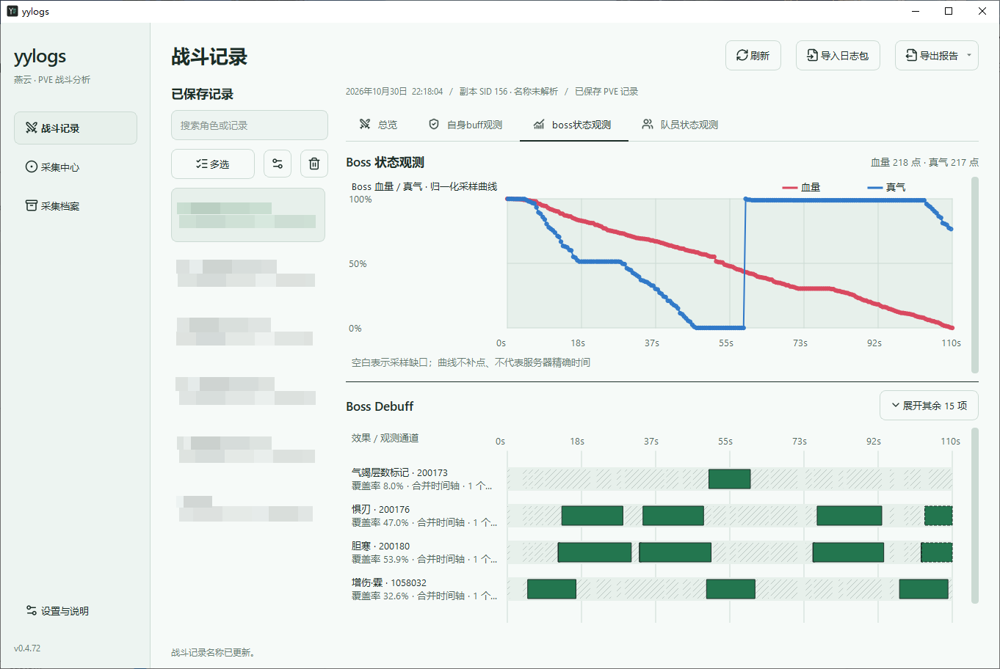
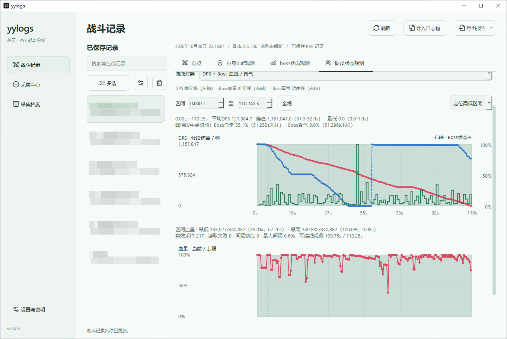
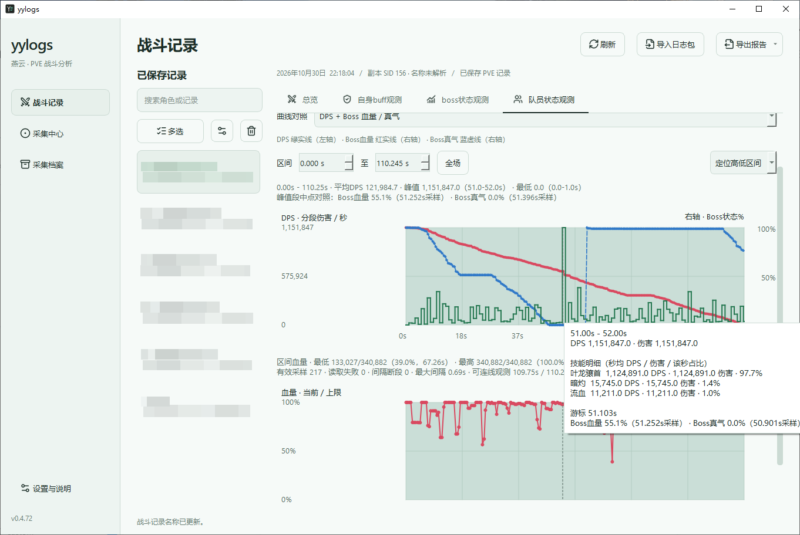

# yylogs · 燕云十六声 PVE 战斗分析工具

> 面向《燕云十六声》组队 PVE 的**本地离线战斗记录与复盘工具**：在一场副本战斗结束后，把这一场里发生的伤害、增益覆盖、Boss 状态和队友表现，整理成可回看、可对比的时间轴和报表。

<p>
  
  
  
  
</p>

## 这个程序是干什么的

一场副本打得好不好，通常只能靠记忆和地面数字。yylogs 的定位是**战斗后的复盘工具**：

1. 在你自己准备好之后**手动开始采集**（不会自动启动），战斗结束停止；
2. 把这一场战斗里玩家实际造成的伤害、受到的治疗、自身增益的覆盖区间、Boss 的血量与真气变化、Boss 身上的减益状态，全部记录下来；
3. 登录后以「战斗记录」的形式回看：总览、自身 Buff、Boss 状态、队员状态四个视角，任选时间区间对比。

它只回答一类问题：**这场战斗里，谁在什么时间做了什么、状态如何变化。**
它不是插件、不是外挂、不参与战斗操作，也不会替你做任何决策。

## 主要功能

| 模块 | 内容 |
| --- | --- |
| 战斗记录 | 记录列表、改名、多选删除、日志包导入导出 |
| 总览 | 队伍总伤害、观测用时、平均 DPS、成员排行、伤害占比、提供 RD |
| 自身 Buff 观测 | 自己身上的增益/减益，按效果与 ID 分轨显示覆盖区间，支持按名称、Buff ID、来源搜索 |
| Boss 状态观测 | Boss 血量 / 真气归一化曲线（同一时间轴），Boss Debuff 覆盖率与展开明细 |
| 队员状态观测 | 单个队员的 DPS/HPS 曲线，可与 Boss 血量、真气叠加对照，定位高低区间 |
| 技能明细 | 在 DPS 曲线上悬停，查看该秒内每个技能的秒伤、伤害与占比 |
| 结算伤害 | 与游戏内结算面板核对的结算类伤害，单独归类、不重复计入总伤 |
| RD 估算 | 按增伤 Buff 的**实际覆盖区间**内队友真实技能伤害估算“我提供了多少 RD”，不是套全场伤害的固定公式 |

## 界面预览

### 总览：队伍伤害与提供 RD


### 自身 Buff 观测：覆盖区间与来源


### Boss 状态观测：血量 / 真气曲线 + Debuff 覆盖率


### 队员状态观测：DPS 与 Boss 状态同轴对照


### 曲线悬停：这一秒打了什么技能


## 目录框架

本仓库只包含**项目框架与设计文档，不包含任何源码**。程序本体以安装包形式分发。

```text
yylogs/
├─ docs/                 设计文档与界面图
│  ├─ images/            界面截图
│  ├─ architecture.md    模块划分与数据流
│  └─ data-scope.md      数据口径、可核对项与不确定性说明
├─ src/                  目录骨架（占位，无实现）
│  ├─ capture/           采集层
│  ├─ analysis/          解析与统计层
│  ├─ ui/                界面层
│  └─ resources/         名称/配置等静态资源
├─ packaging/            打包与分发说明
├─ README.md
└─ LICENSE
```

各目录的职责边界见 [`docs/architecture.md`](docs/architecture.md)。

## 技术与实现概览

- **平台**：Windows x64，单文件 EXE + 独立依赖安装包
- **界面**：Qt（PySide6），浅色主题，图标为自绘 SVG 线性图标
- **采集**：运行期只读观测，字段白名单，不写游戏内存、不调用游戏功能、不绕过保护
- **数据**：全部保存在本机（`%LOCALAPPDATA%/YYLOGS`），不做云端上传
- **分析**：离线流式统计，逐次事件 → 分段聚合 → 曲线/报表，可导出 CSV 与日志包

## 使用方式

1. 启动程序（不会自动开始采集）；
2. 进入副本、准备就绪后点击开始采集；
3. 战斗结束、采集停止后，到「战斗记录」里查看本场分析；
4. 需要复盘或分享时，用「导出报告 / 导入日志包」传递记录。

采集依赖本机环境与游戏版本，跨机器分发请使用安装包。

## 已知限制

- 只做**离线统计**，不是服务器权威数据；曲线存在采样间隔，缺口不补点、不插值；
- 采集有容量上限，超长战斗可能被截断，界面会提示截断位置；
- RD 为**估算值**：只在“能被观测并归属”的区间内累计，无法证明来源的部分不补造；
- 未签名安装包，Windows 可能提示未知发布者。

## 说明

本仓库用于介绍程序用途与设计结构，**不提供源码**。未经许可不得复制、分发或商用，详见 [LICENSE](LICENSE)。
