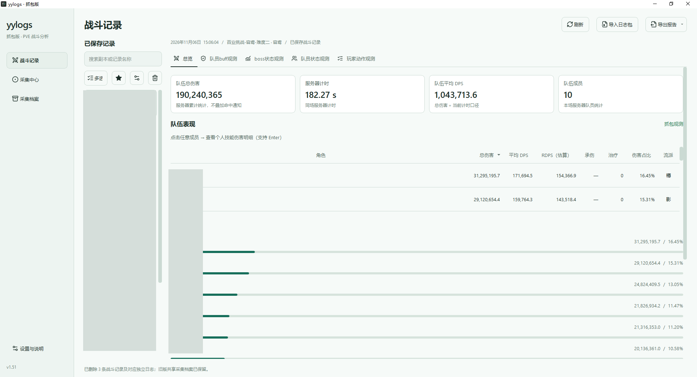
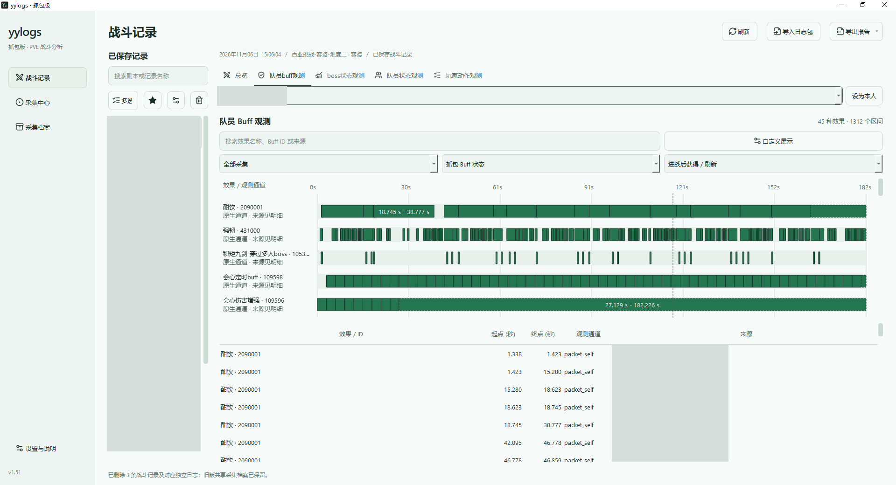
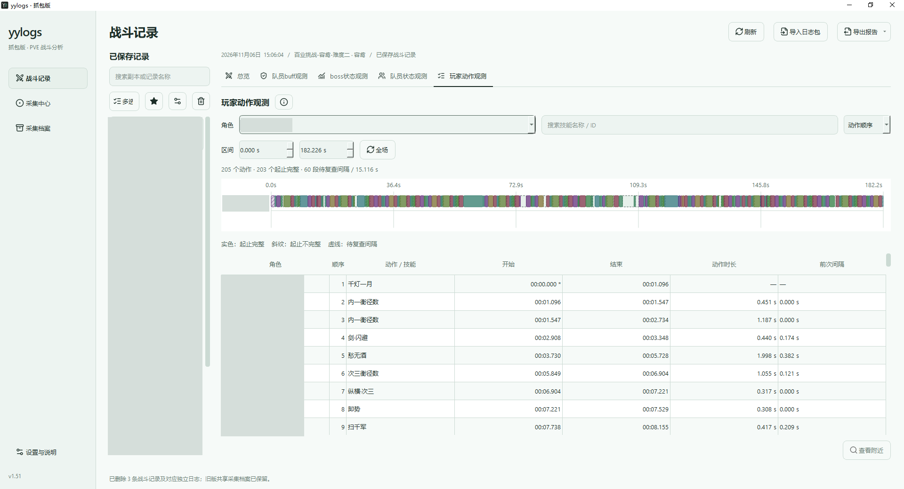

# yylogs · 燕云十六声 PVE 战斗复盘

yylogs 是一个 Windows 桌面工具，用来复盘《燕云十六声》的组队 PVE 战斗。导入已保存的战斗记录后，可以查看队伍输出、技能明细、增益覆盖和 Boss 状态，并对照时间轴分析战斗的关键阶段。

本仓库是基于 **yylogs 1.51** 整理的**离线复盘版源码**。不包含实时采集、实时悬浮窗、抓包运行时、游戏进程读取工具或安装包。使用时无需启动游戏或授予管理员权限。本项目与游戏官方无关。

## 能看什么

| 页面 | 内容 |
| --- | --- |
| 战斗总览 | 队伍总伤害、战斗时长、队员 DPS、伤害占比、流派与 rDPS 估算；点击成员查看技能明细 |
| 队员 Buff 观测 | 按角色查看 Buff 覆盖区间和可识别来源 |
| Boss 状态观测 | 切换观测实体，查看血量、真气和 Debuff；真气归零段以绿色表示 |
| 队员状态观测 | 查看分段 DPS 和血量，对照 Boss 曲线定位爆发或断档 |
| 玩家动作观测 | 查看已记录的动作顺序、起止时间和间隔 |

## 从源码启动

在 Windows x64 安装 Python 3.12。下载或克隆仓库后，在仓库根目录打开 PowerShell：

```powershell
py -3.12 -m venv .venv
.\.venv\Scripts\python.exe -m pip install -r requirements.txt
.\.venv\Scripts\python.exe -m yylogs.app
```

首次启动没有内置战斗记录，列表为空是正常的。默认数据目录为 `%LOCALAPPDATA%\YYLOGS-Offline`，与原版记录分开。可在设置中选择保存目录，重启后生效，不会自动搬移旧数据。

## 怎样复盘

1. 在已有记录的 yylogs 中选择一场战斗，通过「导出报告 → 战斗记录包」取得 `.yylogs` 文件。
2. 在离线复盘版点击「导入日志包」，选择该文件。支持兼容的战斗记录 ZIP 或 JSON；CSV 是统计结果，不能作为日志包导回。
3. 从左侧选择战斗，通过上方标签切换视图。点击总览里的队员可打开技能明细；使用时间区间筛选查看战斗片段。
4. 需要分享或继续分析时，导出战斗记录包、JSON 或队伍统计 CSV。导出只写本地文件；分享前请检查角色名等信息。

rDPS 是基于记录中可归属伤害与 Buff 覆盖的估算，并非官方结算。旧日志没有记录的字段可能留空，导入不能补回未保存的观测。

## 目录

| 路径 | 用途 |
| --- | --- |
| `yylogs/app.py`、`yylogs/ui_shell.py` | Qt 桌面入口、页面导航和战斗记录列表 |
| `yylogs/battle_records.py`、`yylogs/data.py` | 本地档案校验、导入导出和列表加载 |
| `yylogs/packet_records.py`、`yylogs/*_views.py` | 已保存记录的统计与图表；不捕获网络流量 |
| `yylogs/resources/` | 离线分析所需的名称映射、规则和图标 |
| `docs/images/` | 脱敏界面效果图 |

## 界面效果

以下为原版效果图。离线复盘版保留这些战斗分析视图，不提供截图中的采集中心。

### 战斗总览


### 队员 Buff 观测


### Boss 状态观测


### 队员状态观测


### 玩家动作观测


## 许可

源码可查看，不代表授予再分发或商业使用许可。详见 [LICENSE](LICENSE)。图标的第三方许可见 [LICENSE.lucide](yylogs/resources/icons/LICENSE.lucide)。
